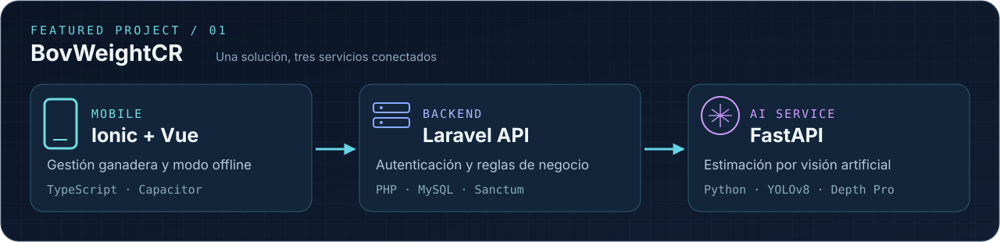

  

  
  
  

### `> whoami`

Soy **Maylo Parra**, desarrollador **full stack** de Costa Rica y estudiante en la etapa final del Bachillerato en **Informática Empresarial de la Universidad de Costa Rica**.

Desarrollo aplicaciones **web y móviles**, **API REST** y funcionalidades para sistemas empresariales. Me interesan la arquitectura de software, las pruebas, la seguridad y la ingeniería asistida por IA, con especial atención a la mantenibilidad.

### `> cat experience.md`

**Desarrollador full stack · Práctica profesional en Softlithe**

Colaboro en el desarrollo y mantenimiento de un **ERP para clínicas y ópticas** que integra pacientes, expedientes, citas, inventario y facturación.

- Mantenimiento, corrección de errores y mejoras de módulos existentes.
- Funcionalidades de punta a punta: **SQL Server → APIs .NET/C# → interfaces React**.
- Frontend de una aplicación móvil con **Ionic y Angular**, conectada a una API en **.NET**.
- Comparación de herramientas y servicios para apoyar decisiones técnicas.

> El ERP es software privado: por confidencialidad, no publico código ni capturas internos.

### `> open maylocode.dev`

**[MayloCode](https://maylocode.dev)** es mi portafolio profesional, donde presento mi experiencia, proyectos y servicios de desarrollo, con contacto para empresas y reclutadores.

Su nueva propuesta visual, **«Hilo de luz»**, combina una estética oscura con acentos cian y violeta, una aurora animada en **WebGL** y un recorrido visual entre secciones. El diseño se plantea con **Astro**, priorizando rendimiento, claridad y accesibilidad.

<a href="https://maylocode.dev"><strong>🌐 Explorar MayloCode</strong></a>

### `> featured --project bovweightcr`

  

**BovWeightCR** es un proyecto académico de gestión ganadera y estimación del peso bovino mediante imágenes. Integra una aplicación móvil, una API REST y un microservicio de visión artificial con **YOLOv8 y Depth Pro**.

**Mi aporte:** selección de modelos, desarrollo del microservicio de ML y una parte importante de la API en Laravel; integración entre servicios y frontend, ajustes de interfaz y pruebas QA.

| Aplicación móvil | Backend REST | Microservicio de IA |
|:---:|:---:|:---:|
| [Ionic · Vue · Capacitor](https://github.com/Mayloparra24/BowWeightCR_FrontEnd) | [Laravel · MySQL](https://github.com/Mayloparra24/BowWeightCR_BackEnd) | [FastAPI · YOLOv8 · Depth Pro](https://github.com/Mayloparra24/bovweight-api) |

### `> ls projects/`

| Proyecto | Mi contribución | Stack |
|---|---|---|
| [**Gestor de Restaurante**](https://github.com/Mayloparra24/GestorDeRestaurante) | Proyecto colaborativo para gestión de mesas y pedidos. Participé en gestión de usuarios, pedidos y pruebas QA. | `C#` `ASP.NET MVC` `SQL Server` |
| [**Weather App**](https://github.com/Mayloparra24/Vue3_Grupo1) | Aplicación de clima con API externa. Implementé videos de fondo según las condiciones del clima y mejoras en la presentación de la información. | `Vue 3` `JavaScript` |

### `> cat stack.md`

| Área | Tecnologías |
|---|---|
| **Frontend** | React, Angular, TypeScript, Vue, Astro |
| **Backend** | .NET / C#, Laravel, Python, FastAPI |
| **Móvil** | Ionic, Capacitor |
| **Datos** | SQL Server, PostgreSQL, MySQL |
| **Herramientas** | Git, GitHub Actions, Docker, Linux |

Exploro flujos de **desarrollo asistido por agentes de IA**, con énfasis en revisión de código, pruebas y automatización.

### `> git log --open-source --highlights`

- **[Chenaikit · PR #349](https://github.com/nexoraorg/chenaikit/pull/349)** — contribución **fusionada** para estandarizar categorías compartidas de errores en contratos Rust/Soroban, con pruebas y documentación.
- **[Gentle Shell · Issue #2469](https://github.com/Gentleman-Programming/gentle-shell/issues/2469)** — reporte reproducible sobre desinstalación y configuración de npm en Windows.
- **[Gentle Shell · Issue #2468](https://github.com/Gentleman-Programming/gentle-shell/issues/2468)** — investigación de un fallo de persistencia de memoria.
- **[Engram · Issue #1937](https://github.com/Gentleman-Programming/engram/issues/1937)** — reporte técnico sobre problemas de escritura SQLite en Windows.

> Distingo entre contribuciones fusionadas y reportes técnicos: ambos aportan valor, pero no son equivalentes.

---

  <strong>¿Hablamos de un proyecto o una oportunidad profesional?</strong>
    
  <a href="https://maylocode.dev"><strong>🌐 Portafolio y servicios</strong></a> · <a href="https://www.linkedin.com/in/maylo-parra-aguirre-298a61173/"><strong>💼 LinkedIn</strong></a> · <a href="https://maylocode.dev/#contacto"><strong>✉️ Contacto</strong></a>
    
  MayloCode · Costa Rica 🇨🇷

